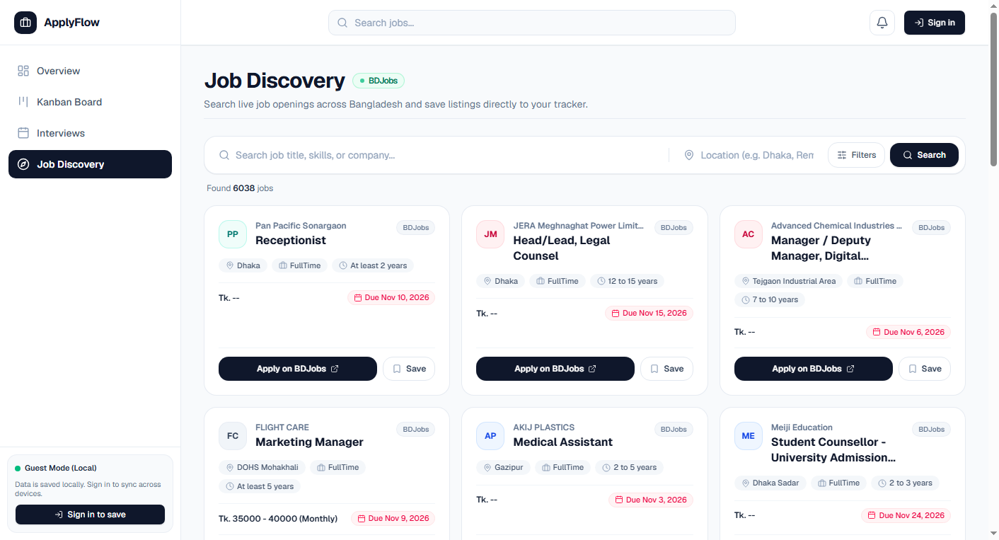
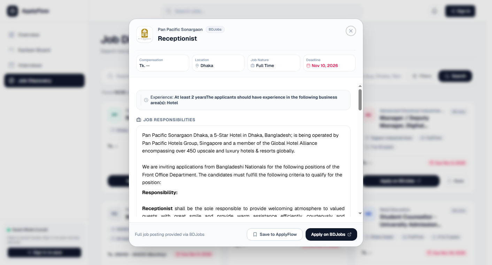
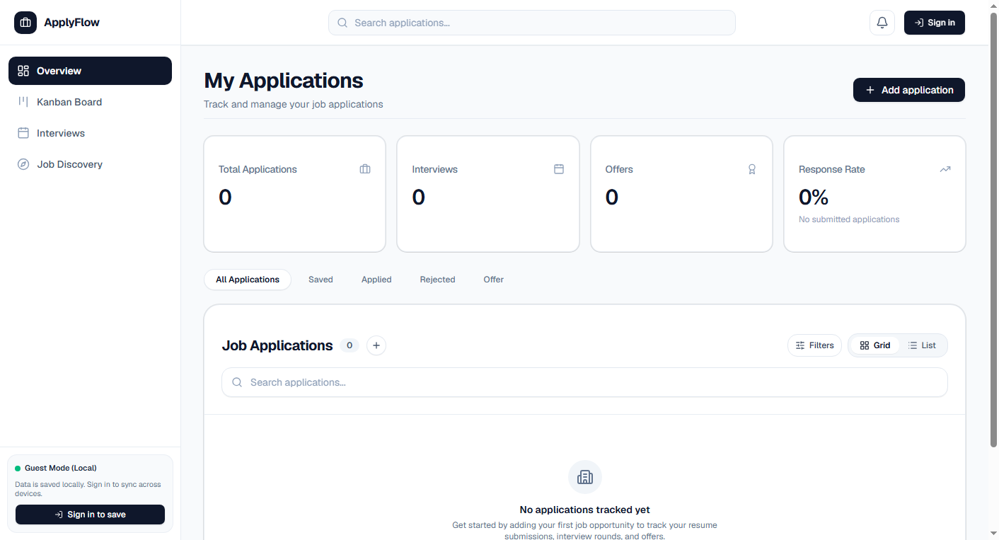
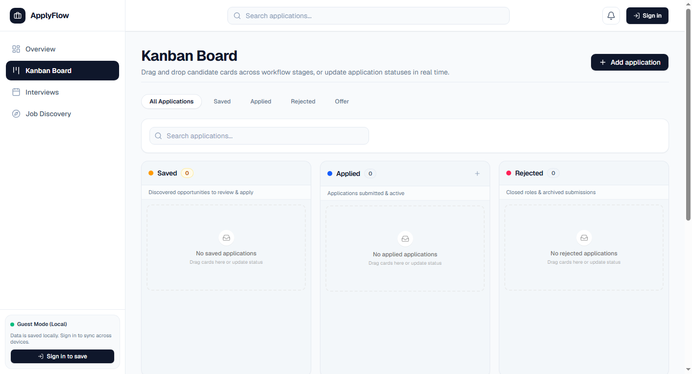
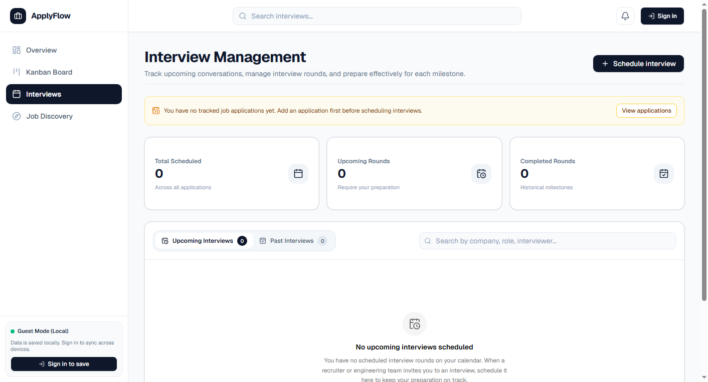

# ApplyFlow 🚀

> **A modern, full-stack job application tracker and career management platform with live BDJobs discovery.**

ApplyFlow streamlines your entire job hunt — from discovering active listings and saving opportunities to tracking application pipelines, scheduling multi-round interviews, and monitoring your response metrics.

---

## 📸 Application Screenshots

### 1. Live Job Discovery (BDJobs Integration)
Search live job openings across Bangladesh with smart filters for Category, Experience (Entry Level), Location, Workplace, and Salary.



---

### 2. Complete Job Specifications & Details Modal
Click any discovered job card to review detailed responsibilities, educational requirements, deadlines, compensation, and experience criteria directly from BDJobs.



---

### 3. Application Pipeline & Overview Dashboard
Monitor your total application volume, interview conversion rates, active offers, and recently tracked opportunities at a glance.



---

### 4. Interactive Kanban Workflow
Drag and drop applications across customizable recruitment stages: **Saved**, **Applied**, **Interviewing**, **Offer**, and **Rejected**.



---

### 5. Interview Management & Upcoming Reminders
Track upcoming phone screenings, technical rounds, and behavioral conversations with automated header notification alerts.



---

## ✨ Key Features

- 🔍 **Live Job Discovery**: Direct integration with BDJobs public search API (`api.bdjobs.com`), complete with real-time in-memory filtering (Entry Level intern roles, locations, employment types, disclosed salaries).
- 🏷️ **Clean Card Presentation**: Transparent salary displays (`Tk. --` placeholder for undisclosed salaries, no erroneous currency prefixes) and clean metadata tags.
- 📋 **Detailed Job Modal**: View full employer information, job responsibilities, candidate requirements, and direct application links without leaving ApplyFlow.
- 📌 **Instant Saving & Duplicate Prevention**: Save opportunities to your tracker in one click with built-in deduplication guards.
- 📊 **Dynamic Dashboard Metrics**: Calculate authentic application totals, response rates, and interview pipeline stages without hardcoded or fabricated numbers.
- 🔔 **Interview Scheduler & Notifications**: Organize interview schedules, dates, and interviewers with an active header notification bell.
- 🌐 **Dual-Mode Persistence**:
  - **Guest Mode**: Zero-friction local experimentation backed by versioned `localStorage`.
  - **Cloud Mode**: Seamless Neon PostgreSQL cloud synchronization with user data isolation.
- 🛡️ **Production Security**: Authenticated sessions using secure `HttpOnly; SameSite=Lax` cookies, eliminating cross-site cookie blocking across Safari, iOS, and Chrome.

---

## 🛠️ Technology Stack

| Domain | Technology | Purpose |
|---|---|---|
| **Frontend** | React 19 + TypeScript | High-performance reactive UI with component modularity |
| **Styling** | Tailwind CSS v4 + Radix UI | Modern design system, accessible primitives, sleek glassmorphism |
| **Icons** | Lucide React | Consistent iconography across sidebar, cards, and mobile bottom bar |
| **Notifications** | Sonner | Fluid, non-blocking toast notifications |
| **Backend** | Express + TypeScript | Lightweight REST API routing with structured error handling |
| **Database** | Neon PostgreSQL + Prisma ORM | Serverless PostgreSQL with connection pooling and schema migrations |
| **Job Search** | BDJobs Search & Details API | Live provider querying with resilient timeouts and caching |
| **Authentication** | Google Identity Services + Password Auth | Dual-provider auth with encrypted session cookies |
| **Deployment** | Vercel (Hobby Tier) | Serverless single-origin full-stack deployment |

---

## 🚀 Getting Started

### Prerequisites

- **Node.js**: `v20.x` or higher (tested on Node `v24.x`)
- **npm**: `v10.x` or higher
- **PostgreSQL**: Local instance or free [Neon](https://neon.tech) serverless database

### 1. Clone the Repository

```bash
git clone https://github.com/your-username/applyflow.git
cd applyflow
```

### 2. Install Dependencies

```bash
# Install root dependencies
npm install

# Install server dependencies
npm --prefix server install
```

### 3. Environment Configuration

Copy the example environment files:

```bash
cp .env.example .env.local
```

Configure your `.env.local` file:

```env
# Database (Neon Serverless PostgreSQL)
DATABASE_URL="postgresql://<user>:<password>@<ep-pooler>.us-east-1.aws.neon.tech/neondb?sslmode=require&pgbouncer=true"

# Authentication & Runtime
NODE_ENV="development"
ENABLE_DEMO_AUTH="true"
SESSION_SECRET="your-development-session-secret"

# Optional: Google OAuth 2.0 (GIS)
VITE_GOOGLE_CLIENT_ID=""
GOOGLE_CLIENT_ID=""

# Optional: Email Service for Password Reset (Resend)
RESEND_API_KEY=""
EMAIL_FROM="ApplyFlow <onboarding@resend.dev>"
```

### 4. Database Setup & Migrations

```bash
# Apply Prisma schema migrations
npm run prisma:deploy
```

### 5. Run Local Development Servers

Start both frontend and backend development servers concurrently:

```bash
# Terminal 1: Vite Frontend Dev Server (http://localhost:5173)
npm run dev

# Terminal 2: Express Backend Server (http://localhost:5000)
npm run server:dev
```

Open [http://localhost:5173](http://localhost:5173) in your browser.

---

## 🧪 Testing & Quality Assurance

ApplyFlow maintains a test suite covering backend API endpoints, storage recovery, database isolation, metric calculations, and BDJobs provider integrations:

```bash
# Run all automated unit and integration tests (138 tests)
npm test -- --run

# Run ESLint validation
npm run lint

# Run TypeScript typechecks
npm run server:typecheck
npx tsc -b

# Run full production build
npm run build
```

---

## 🚢 Production Deployment

For detailed, step-by-step instructions on deploying ApplyFlow to **Vercel** with a free-tier **Neon PostgreSQL** database, refer to the [Production Deployment Guide](DEPLOYMENT.md).

---

## 📄 License

This project is open-source and available under the [MIT License](LICENSE).
